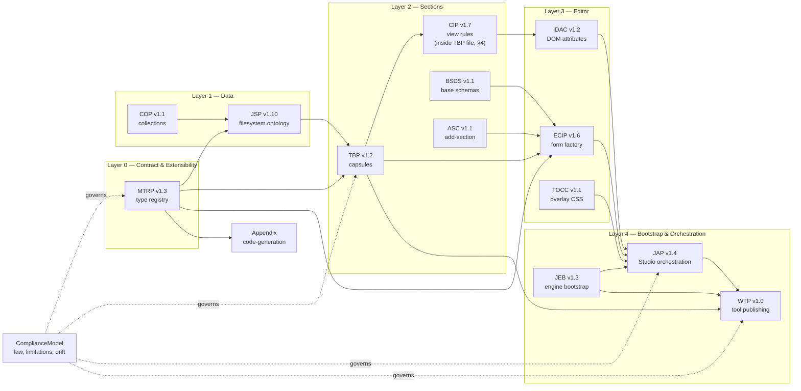

# OlonJS Specifications 2.0 — Index

**What OlonJS is:** a deterministic contract between websites and AI agents. The guiding principle: **the JSON data structure is the contract** — from a single typed source derive rendering, validation, machine access, and SEO. Every technical choice (Zod schemas, `ui:*` descriptors, `data-jp-*` DOM attributes, stable IDs) is part of that contract, so every section is inspectable and operable by an agent.

This folder is the modular protocol set. **This index is the entry point**: it explains the dependency graph, gives a reasoned reading order, and maps every protocol to the role that needs it. It is also the **single source of truth for protocol versions**.

> Note: the `## N.` numbers inside individual files are historical and not uniform (some protocols are unnumbered, CIP lives inside the TBP file). The canonical order is the one in this index.

## Dependency Graph

## Reading Order (canonical)

Read in this order; each step states what it unlocks.

1. **[MTRP — Modular Type Registry Pattern v1.3](MTRP_1.3.md)** — the extensibility law. Every other protocol assumes types extended via module augmentation without touching the Core. *Unlocks: understanding why tenants never fork the core.*
2. **[JSP — JsonPages Site Protocol v1.10](JSP_1.10.md)** — the deterministic filesystem ontology: where every document lives (`config/` for global governance, `pages/` for content). *Unlocks: the data substrate every other protocol operates on.*
3. **[TBP — Tenant Block Protocol v1.2](TBP_1.2.md)** — the atomic unit: the section capsule (`View.tsx`, `schema.ts`, `types.ts`, `index.ts`, optional `webmcpTools.ts`). *Unlocks: the subject of the whole system.*
4. **[CIP — Component Implementation Protocol v1.7](TBP_1.2.md)** — view rules, §4 of the TBP file: schema-blind views, theme chain, z-index neutrality, asset resolution. *Unlocks: how a capsule's View must behave.*
5. **[COP — Collection Protocol v1.1](COP_v1.1.md)** — collections independent from pages, consumed via `$ref` bindings. *Unlocks: shared content across pages.*
6. **[BSDS — Base Section Data & Settings v1.1](BSDS_1.1.md)** — the base fragments every capsule schema extends (`BaseSectionData`, `BaseArrayItem`, stable IDs/keys). *Unlocks: schema authoring.*
7. **[ASC — AddSectionConfig v1.1](ASC_1.1.md)** — the add-section contract Studio consumes. *Unlocks: registering a capsule in the editor.*
8. **[ECIP — Editor Component Implementation Protocol v1.6](ECIP.md)** — the schema-driven editor contract: Form Factory, `ui:*` descriptors, path-based selection. *Unlocks: how Studio turns schemas into editors.*
9. **[IDAC — ICE Data Attribute Contract v1.2](IDAC_1.2.md)** — `data-jp-*` DOM attributes that make every editable element machine-readable. *Unlocks: Stage selection, Inspector, and agent operability.*
10. **[TOCC — Tenant Overlay CSS Contract v1.1](TOCC_1.1.md)** — tenant CSS selectors for the Studio overlay. *Unlocks: styling the editing experience.*
11. **[JEB — JsonPagesConfig & Engine Bootstrap v1.3](JEB_1.3.md)** — the bootstrap contract between tenant app and `JsonPagesEngine`, including `WebMcpConfig`. *Unlocks: the runtime boundary between tenant data and Core orchestration.*
12. **[JAP — OlonJS Admin Protocol v1.4](JAP_1.4.md)** — deterministic Studio orchestration: Stage, Inspector, Working Draft, persistence, declared admin tools. *Unlocks: how editing flows are orchestrated.*
13. **[WTP — WebMCP Tool Publishing Protocol v1.0](WTP_1.0.md)** — how tenant developers publish their own WebMCP tools from section capsules, with `admin | public` surface. *Unlocks: the agent-facing capabilities of a tenant.*
14. **[ComplianceModel](ComplianceModel.md)** — architectural law vs. limitations vs. tenant drift: how to judge any implementation against this set. *Unlocks: the verdict layer — read last, apply always.*
15. **[Appendix](Appendix.md)** — code-generation annex. *Unlocks: how tenant code is generated from these contracts.*

## Protocol Map

| Protocol | Version | File | Roles | One-liner |
|---|---|---|---|---|
| MTRP | 1.3 | [MTRP_1.3.md](MTRP_1.3.md) | `tenant-dev`, `core-contract` | Type extensibility via module augmentation |
| JSP | 1.10 | [JSP_1.10.md](JSP_1.10.md) | `tenant-dev` | Deterministic filesystem ontology |
| TBP | 1.2 | [TBP_1.2.md](TBP_1.2.md) | `tenant-dev` | Section capsule structure |
| CIP | 1.7 | [TBP_1.2.md](TBP_1.2.md) §4 | `tenant-dev` | View rules: schema-blind, theme chain, z-index |
| COP | 1.1 | [COP_v1.1.md](COP_v1.1.md) | `tenant-dev` | Collections consumed via `$ref` |
| BSDS | 1.1 | [BSDS_1.1.md](BSDS_1.1.md) | `tenant-dev`, `studio-work` | Base schema fragments, stable IDs |
| ASC | 1.1 | [ASC_1.1.md](ASC_1.1.md) | `tenant-dev`, `studio-work` | Add-section contract |
| ECIP | 1.6 | [ECIP.md](ECIP.md) | `tenant-dev`, `studio-work` | Schema-driven editor: Form Factory, `ui:*` |
| IDAC | 1.2 | [IDAC_1.2.md](IDAC_1.2.md) | `tenant-dev`, `studio-work`, `agent-authoring` | `data-jp-*` DOM contract |
| TOCC | 1.1 | [TOCC_1.1.md](TOCC_1.1.md) | `tenant-dev`, `studio-work` | Overlay CSS selectors |
| JEB | 1.3 | [JEB_1.3.md](JEB_1.3.md) | `tenant-dev`, `core-contract`, `studio-work` | Engine bootstrap + `WebMcpConfig` |
| JAP | 1.4 | [JAP_1.4.md](JAP_1.4.md) | `studio-work`, `core-contract` | Studio orchestration + admin tool dispatch |
| WTP | 1.0 | [WTP_1.0.md](WTP_1.0.md) | `agent-authoring`, `tenant-dev` | Dev-published WebMCP tools, `admin\|public` surface |
| ComplianceModel | — | [ComplianceModel.md](ComplianceModel.md) | all | Law vs. limitations vs. tenant drift |
| Appendix | — | [Appendix.md](Appendix.md) | `core-contract`, `tenant-dev` | Code-generation annex |

## Role-Based Quick Paths

**Building a site (tenant-dev):**
MTRP → JSP → TBP/CIP → COP → BSDS → ASC → ECIP → IDAC → TOCC → JEB → WTP → ComplianceModel

**Working on the Studio/editor (studio-work):**
ECIP → IDAC → TOCC → JEB → JAP → ComplianceModel (+ BSDS/ASC for schema authoring)

**Publishing tools for agents (agent-authoring):**
TBP (capsule) → JEB (`WebMcpConfig`) → JAP (§8, admin dispatch) → WTP → IDAC (machine-readable DOM) → ComplianceModel

## Maintenance Notes

- **This index is the SSOT for protocol versions.** When a protocol bumps, update the table here, then `CLAUDE.md` (which points to this index as entry point).
- The files in this folder are mirrored byte-identically in `.cursor/skills/olonjs-tenant2/references/` — mirror the index there too on any change.
- Never edit a protocol's normative text from here; changes happen in the protocol file, then the index table is refreshed.
